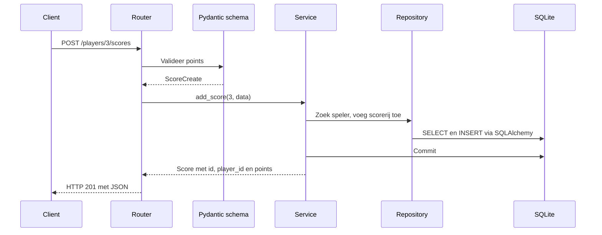

# Sprint 5: een overzichtelijke Game Score API

## Doel en analyse van de beginsituatie

Sprint 4 heeft een werkende API met permanente SQLite-opslag. Het bestand
`sprint4.py` bevat 274 regels en combineert alle onderstaande verantwoordelijkheden.
Voor deze kleine API is dat leesbaar, maar bij nieuwe functionaliteit moet een
developer steeds tussen endpoints, validatie en databasecode zoeken.

| Vraag uit de sprint | Situatie vóór de refactor |
| --- | --- |
| Waar staan de endpoints? | Tien endpoints binnen `create_app()` in `sprint4.py` |
| Waar staan de database models? | `Base`, `PlayerRow` en `ScoreRow` boven in hetzelfde bestand |
| Waar staan de Pydantic schemas? | `ApiStatus`, `PlayerCreate`, `ScoreCreate`, `Player`, `Score` en `ErrorResponse` in hetzelfde bestand |
| Waar staat de databasecode? | Engine, sessies en initialisatie in `create_app()`; queries in helpers én endpoints |
| Welk bestand combineert veel taken? | `sprint4.py`: appconfiguratie, database, validatie, spelregels en HTTP |
| Welke code doet meerdere dingen? | `create_player()` maakt een rij, normaliseert de naam, commit, verwerkt databasefouten en zet een HTTP-header |

Bij de begincontrole slaagden alle 29 bestaande tests. De lege bestanden
`sprint3.py` en `sprint4.py` buiten de map `Python leren` horen niet bij deze Git-repository.

## Refactorplan

1. Leg bestaand gedrag vast met de bestaande tests: routes, JSON, statuscodes en opslag.
2. Verplaats de SQLAlchemy models en Pydantic schemas naar aparte packages.
3. Haal verbindingen, database-initialisatie en request-sessies uit de endpoints.
4. Verplaats queries naar repositories en spelregels naar services.
5. Groepeer endpoints in APIRouters voor algemeen, spelers, scores en leaderboard.
6. Laat `app/main.py` uitsluitend de applicatie samenstellen en haar levensduur beheren.
7. Draai hetzelfde database-/HTTP-testcontract tegen Sprint 4 én Sprint 5.
8. Test ook gebruik van bestaande databases, rollback en gescheiden app-instanties.
9. Documenteer de keuzes, verdeel wijzigingen over commits en laat een klasgenoot reviewen.

De nieuwe uitvoering staat in `app/` en start met `sprint5.py`. Sprint 1 tot en
met 4 blijven beschikbaar als eerdere leeropdrachten. Voor Sprint 5 gebruik je
de modulaire versie; voeg nieuwe endpoints aan haar routers toe.

## Projectstructuur en Separation of Concerns

Separation of Concerns betekent dat ieder onderdeel een afgebakende taak heeft.
Een wijziging aan de ranglijst hoort daardoor in de service; een wijziging aan
een SQL-query hoort in een repository. Je hoeft daarvoor geen endpoint te veranderen.

```text
Python leren/
├── sprint5.py                # startscript
├── app/
│   ├── main.py               # app factory, levensduur en routers registreren
│   ├── database.py           # engine, sessiefabriek, tabellen en voorbeelddata
│   ├── dependencies.py       # sessie per request en validatie van player_id
│   ├── handlers.py           # businessfouten naar HTTP-antwoorden vertalen
│   ├── routers/
│   │   ├── general.py        # GET /
│   │   ├── players.py        # speler-CRUD
│   │   ├── scores.py         # scorelijsten en punten toevoegen
│   │   └── leaderboard.py    # GET /leaderboard
│   ├── services/
│   │   ├── players.py        # spelers, unieke namen en ranglijst
│   │   ├── scores.py         # scores bij bestaande spelers
│   │   └── errors.py         # PlayerNotFoundError en DuplicateUsernameError
│   ├── repositories/
│   │   ├── players.py        # spelerrijen ophalen, toevoegen, wijzigen en wissen
│   │   └── scores.py         # scorerijen ophalen, toevoegen en optellen
│   ├── models/
│   │   ├── base.py           # gedeelde SQLAlchemy Base
│   │   ├── player.py         # players-tabel
│   │   └── score.py          # scores-tabel
│   └── schemas/
│       ├── common.py         # status- en foutantwoord
│       ├── player.py         # PlayerCreate en Player
│       └── score.py          # ScoreCreate en Score
├── tests/test_sprint5.py     # extra regressietests
├── test_sprint4.py           # gedeelde contracttests voor Sprint 4 en Sprint 5
└── docs/
    ├── sprint5.md
    └── sprint5-feedback.md
```

De packages bevatten ook `__init__.py`. De extra repositorylaag zorgt dat
services geen SQL-queries bevatten. Voor een grotere API is dat handig:
databasewerk blijft op één plek en een tweede endpoint kan dezelfde service gebruiken.

FastAPI groepeert endpoints met `APIRouter`; `include_router()` registreert
ze op de app. Hier behouden de routers dezelfde paden als in Sprint 4.
Zie [FastAPI: Bigger Applications](https://fastapi.tiangolo.com/tutorial/bigger-applications/).

## Wat is de service layer?

Een service bundelt een gebruiksactie en de regels die daarbij horen.
`PlayerService` bepaalt bijvoorbeeld dat namen zonder hoofdletterverschil uniek
zijn en dat het leaderboard sorteert op aflopende score, daarna op oplopend ID.
`ScoreService` controleert of de speler bestaat voordat punten worden toegevoegd.
De services bewaken ook de transactie: wijzigingen worden gecommit of bij een
dubbele naam teruggedraaid met rollback.

Services gebruiken geen FastAPI of `HTTPException`. Een ontbrekende speler
geeft `PlayerNotFoundError`; `handlers.py` maakt daarvan een HTTP 404 met
dezelfde fouttekst als voorheen. Daardoor zijn de spelregels ook vanuit een
Python-script bruikbaar. De test van de service laat dit zonder HTTP zien.



Een `Session` is de werkeenheid voor databaseacties. Alle onderdelen van één
request gebruiken dezelfde sessie. `get_session()` sluit die na het request;
iedere app-instantie heeft een eigen `Database`. De endpoints zijn gewone
`def`-functies, passend bij de bestaande synchrone SQLAlchemy-code.

## Database models versus Pydantic schemas

| Aspect | Database model | Pydantic schema |
| --- | --- | --- |
| Doel | Vorm van opgeslagen gegevens en relaties | Vorm en validatie van API-invoer en -uitvoer |
| Bibliotheek | SQLAlchemy | Pydantic |
| Voorbeeld | `PlayerRow`, `ScoreRow` | `PlayerCreate`, `Player`, `ScoreCreate`, `Score` |
| Beschrijft | Tabellen, kolommen, primary/foreign keys, unieke naam | JSON-velden, types en toegestane invoer |
| Opslag | Via SQLAlchemy-sessies | Schrijft zelf geen data naar SQLite |

`PlayerRow` heeft de interne kolom `username_key` en een relatie met scorerijen.
Het antwoord `Player` bevat alleen `id`, `username` en de berekende `score`.
De totaalscore is geen kolom: de repository telt scorerijen op en de service
maakt het antwoord. `PlayerCreate` accepteert alleen `username`; de client
kan daarmee geen eigen ID of totaalscore kiezen.

`ScoreCreate` accepteert uitsluitend een positief geheel getal. `Score` kan met
`from_attributes=True` een SQLAlchemy-rij omzetten naar openbare antwoordvelden.
De foreign key en unieke naam blijven databaseconstraints, ook wanneer code
zonder HTTP de database benadert. De bestaande tabellen zijn niet gewijzigd.
Zie [SQLAlchemy: declaratieve tabellen](https://docs.sqlalchemy.org/en/20/orm/declarative_tables.html)
en [Pydantic: models](https://docs.pydantic.dev/latest/concepts/models/).

## Hoe imports werken

Een `.py`-bestand is een module. Een map met `__init__.py` is hier een package.
In deze code gebruiken we absolute imports vanaf `app`:

```python
from app.schemas.player import PlayerCreate
from app.services.players import PlayerService
```

De eerste import haalt de klasse uit `app/schemas/player.py`. Start vanuit
`Python leren` met `python sprint5.py` of `python -m uvicorn app.main:app --reload`,
zodat Python de package `app` kan vinden. Start `app/main.py` niet rechtstreeks.
`app.main:app` betekent: importeer module `app.main` en gebruik haar variabele `app`.

De models delen `Base`. `models/__init__.py` importeert beide models zodat
SQLAlchemy hun relaties kent voordat de tabellen worden aangemaakt.
De verwijzingen tussen `PlayerRow` en `ScoreRow` gebruiken stringannotaties
en `TYPE_CHECKING`, zodat hun modules elkaar niet tijdens import hoeven te laden.
Zie [Python: modules en packages](https://docs.python.org/3/tutorial/modules.html).

## Refactoren zonder ander gedrag

De endpoints, validatieregels, foutteksten, JSON-velden en statuscodes blijven
gelijk aan Sprint 4. Alleen de titel, versie en beschrijving van de API zijn
bijgewerkt. Ook de `Location`-header bij een nieuwe speler en het lege antwoord
bij DELETE blijven bestaan. Het databasebestand staat nog op dezelfde plek.
De bestaande players- en scores-tabellen kunnen zonder migratie worden gebruikt.

De gedeelde tests worden met twee app factories uitgevoerd. Zo moeten de oude
en nieuwe uitvoering hetzelfde contract blijven ondersteunen. Extra tests openen
een door Sprint 4 gevulde database met Sprint 5 en daarna opnieuw met Sprint 4.

## Testresultaten en eigen demo

Uitgevoerd op 8 oktober 2026 vanuit `Python leren`:

```powershell
.\.venv\Scripts\python -m pytest -q
```

Resultaat: **60 passed**. De reeds aanwezige TestClient-afhankelijkheid geeft
één deprecation warning; er zijn geen testfouten.

| Gecontroleerd | Bewijs |
| --- | --- |
| Alle tien endpoints, speler-CRUD, score toevoegen en leaderboard | Gedeelde HTTP-tests voor Sprint 4 en Sprint 5 |
| Ongeldige invoer, dubbele namen en ontbrekende spelers | Statuscodes 400, 404, 422 en controle van foutteksten |
| Permanente opslag en verwijderen van scores met een speler | Herstarttests en foreign-key-/cascadecontrole |
| Bestaande database hergebruiken | Sprint 4 → Sprint 5 → Sprint 4 |
| Database-isolatie tussen app-instanties | Twee gelijktijdige TestClients met eigen bestanden |
| Rollback bij dubbele namen | Service werkt daarna verder met dezelfde sessie |
| Totaalscores, gelijke scores en openbare JSON-velden | Aanvullende Sprint 5-tests |
| Lege database blijft leeg na herstart | Geen opnieuw aangemaakte voorbeeldspelers |
| Swagger blijft beschikbaar | `/docs` en `/openapi.json` in contracttests |

Voer de demo uit met een testspeler, noteer steeds het teruggegeven ID:

1. Start `sprint5.py` en open `/docs`.
2. Maak een speler met `POST /players`: `{"username": "Sprint5Demo"}` → 201.
3. Voeg 25 punten toe met `POST /players/{id}/scores` → 201.
4. Controleer de speler, scores en ranglijst → 200, totaalscore 25.
5. Wijzig de naam met `PUT /players/{id}` → 200; de score blijft 25.
6. Herstart de server; controleer dat de gewijzigde naam en punten nog bestaan.
7. Verwijder de testspeler → 204; ophalen geeft vervolgens 404.
8. Probeer een dubbele naam en ongeldige punten → respectievelijk 400 en 422.

## Nieuwe functionaliteit toevoegen en keuzes uitleggen

Voor bijvoorbeeld `GET /players/{id}/average` voeg je een methode aan
`ScoreRepository` toe die het gemiddelde opvraagt, een servicemethode die het
resultaat verwerkt en een endpoint aan de score-router. Een nieuw antwoord krijgt
een eigen schema. Daarna test je de API-uitkomst en relevante foutgevallen.
Zo heeft iedere wijziging een herkenbare plek.

Een korte uitleg die je in je eigen woorden moet kunnen geven:

> Mijn routers regelen HTTP. De services regelen de spelregels en transacties.
> Repositories bevatten databasequeries. Models beschrijven opgeslagen tabellen,
> schemas beschrijven de invoer en antwoorden. Main verbindt deze onderdelen.
> Daardoor kan een andere developer sneller vinden waar een wijziging hoort.

Controleer je begrip: waarom staat `username_key` niet in de response?
Waarom hoort het sorteren van de ranglijst in een service? Waarom mogen een
database model en een schema verschillende velden hebben? Volg één score-request
door de bestanden en leg uit waar validatie, opslag en het HTTP-antwoord gebeuren.

## Definition of done en resterende taken

- [x] De Sprint 5-applicatie is verdeeld over logisch gekozen modules.
- [x] De endpoints gebruiken APIRouter.
- [x] Bestanden en mappen hebben duidelijke namen en verantwoordelijkheden.
- [x] De bestaande CRUD-functionaliteit werkt; de regressietests slagen.
- [x] Analyse, plan, structuurkeuzes en models-versus-schemas-uitleg zijn vastgelegd.
- [ ] Laat minimaal één echte klasgenoot de API en structuur bekijken.
- [ ] Leg ontvangen feedback en je verwerking daarvan vast in het feedbackformulier.
- [ ] Bekijk de API van een klasgenoot en geef concrete feedback.
- [x] De wijzigingen staan in meerdere duidelijke commits op GitHub.
- [ ] Leg zelf de structuur uit en demonstreer de API.

De peer review is nog niet uitgevoerd. Vul alleen echte namen, datums en feedback
in [sprint5-feedback.md](sprint5-feedback.md) in. Zet de sprintkaart pas op Done
nadat ook deze resterende taken zijn afgerond.

De wijzigingen zijn verdeeld over deze commits:

- `refactor: split Game Score API into routers and services`
- `test: verify Sprint 5 CRUD and database compatibility`
- `docs: explain Sprint 5 architecture and peer review`

Controleer ze lokaal met `git log -3 --oneline` of bekijk de
[commitgeschiedenis op GitHub](https://github.com/JeroenMarkusVermeulen/Python-leren/commits/main).
