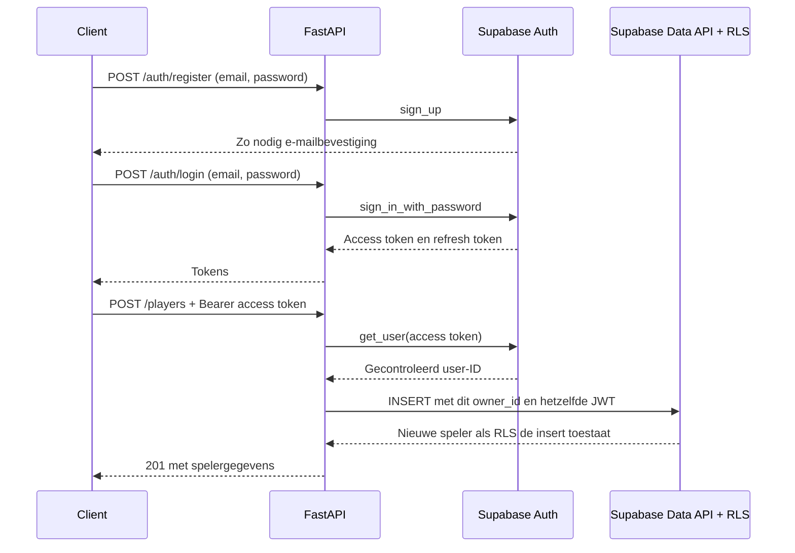

# Sprint 6: Supabase Database en Supabase Auth

## Status

De API gebruikt het aparte Supabase-project
[Game Score API](https://supabase.com/dashboard/project/sbrwjjbvwqaqukxtkirx)
binnen **Jeroen Vermeulen**, in Frankfurt (`eu-central-1`). Het project is op
8 oktober 2026 aangemaakt na toestemming en Supabase-kostencontrole (€0 per maand
bij aanmaak). De schema-migratie en data-import zijn uitgevoerd. De lokale `.env`
bevat de project-URL en publishable key en wordt niet gecommit.

Internly is niet gewijzigd. Een controle van de databasecatalogus bevestigde
dat daar geen `game_players`, `game_scores`, `game_player_totals` of
`game_normalize_username` staan; er was dus niets van deze API te verwijderen.

De lokale bron bevat twee spelers en twee score-registraties: Alice heeft 100
punten en Bob 150. De import is met de bron vergeleken: spelers 1 en 2 en scores
1 en 2 staan in Supabase met dezelfde namen, punten en spelerverwijzingen.
De oorspronkelijke SQLite-database is als bron behouden.

## Authentication en authorization

Authentication controleert wie de gebruiker is. Supabase Auth controleert het
e-mailadres en wachtwoord en geeft een access token en refresh token terug.
Authorization controleert of die gebruiker een actie mag uitvoeren. Hier mag
alleen de eigenaar van een speler diens naam wijzigen, punten toevoegen of de
speler verwijderen. Een login geeft dus geen toegang tot andermans schrijf-acties.
Zie [Supabase Auth](https://supabase.com/docs/guides/auth).

| Actie | Zonder login | Ingelogd |
| --- | --- | --- |
| GET `/`, `/players`, `/players/{id}`, `/scores`, `/players/{id}/scores`, `/leaderboard` | Toegestaan | Toegestaan |
| POST `/auth/register`, `/auth/login`, `/auth/refresh` | Toegestaan, met passende credentials | Toegestaan |
| GET `/auth/me` | 401 | Gegevens van de ingelogde gebruiker |
| POST `/players` | 401 | Nieuwe speler krijgt het Supabase-user-ID als eigenaar |
| PUT of DELETE `/players/{id}` | 401 | Alleen de eigenaar; anders 403 |
| POST `/players/{id}/scores` | 401 | Alleen de eigenaar; anders 403 |

Een ontbrekende speler geeft voor een geldige gebruiker 404; een dubbele
spelernaam geeft 400 en ongeldige invoer 422. Supabase-rate-limits worden 429;
een onbereikbare provider geeft 503. Een 401 bevat `WWW-Authenticate: Bearer`.

## Waarom Supabase?

Supabase brengt PostgreSQL, accountbeheer en JWT-authentication samen. De API
hoeft daardoor geen eigen wachtwoorddatabase of JWT-signing key te beheren.
De officiële Python SDK verstuurt accounts naar Supabase Auth en queries naar
de Data API. Een zelf beheerde wachtwoordhash en een eigen sessietabel waren
een alternatief; bij deze sprint voert Supabase die taken uit.

Gebruik een **publishable key**. De app weigert secret- en service-role-keys,
omdat die database-policies kunnen omzeilen. De echte projectinstellingen staan
in de lokale `.env`, die niet gecommit wordt. Zie
[Supabase API-keys](https://supabase.com/docs/guides/api/api-keys).

## De authentication-flow



`get_user(token)` vraagt de identiteit bij Supabase op; de app vertrouwt geen
ongecontroleerd gedecodeerde JWT-payload. Iedere request krijgt een eigen
Supabase-client en eigen HTTP-client. Server-side sessieopslag en automatische
tokenvernieuwing staan uit, zodat accounts van verschillende requests niet
door elkaar kunnen lopen. Zie
[Supabase: get_user](https://supabase.com/docs/reference/python/auth-getuser).

Als het access token verlopen is, geeft `/auth/me` 401. Gebruik dan
`POST /auth/refresh` met het refresh token of log opnieuw in. Tokens staan niet
in logregels en antwoorden met tokens hebben `Cache-Control: no-store`.

## Wachtwoorden

De API accepteert bij registratie een wachtwoord van 12 tot en met 128 tekens.
Het schema gebruikt `SecretStr`; validatiefouten bevatten geen ruwe invoer.
De server stuurt het wachtwoord over HTTPS naar Supabase Auth. De app bewaart
geen plaintext password en heeft geen eigen password-tabel.

Supabase Auth verzorgt het hashen en opslaan van wachtwoorden in het afgeschermde
`auth`-schema. Dit is wachtwoordhashing, geen omkeerbare versleuteling waarmee
een wachtwoord later kan worden teruggelezen. Zie
[Supabase: password security](https://supabase.com/docs/guides/auth/password-security).

## Database en RLS

| Onderdeel | Verantwoordelijkheid |
| --- | --- |
| `public.game_players` | ID, spelernaam, genormaliseerde unieke naam en eigenaar |
| `public.game_scores` | ID, spelerverwijzing en positieve punten |
| `public.game_player_totals` | View met de som van punten per speler |
| `auth.users` | Door Supabase beheerde accounts, met UUIDs |

De `game_`-prefix maakt de tabellen van deze API herkenbaar. De applicatie krijgt
een eigen Supabase-project. Speler- en score-IDs blijven numeriek. `owner_id` verwijst naar
het UUID van `auth.users`; een speler is dus niet hetzelfde als een account.

De migratie schakelt Row Level Security op beide tabellen in. Lezen is openbaar.
Insert, update en delete van spelers vereisen dat `auth.uid()` gelijk is aan
`owner_id`; score-inserts controleren de eigenaar van de bijbehorende speler.
Anonieme Supabase-accounts zijn uitgesloten van schrijf-acties. `user_metadata`
wordt nooit gebruikt voor toestemming. De totals-view heeft
`security_invoker=true`, zodat zij de policies van de tabellen volgt. Zie
[Supabase RLS](https://supabase.com/docs/guides/database/postgres/row-level-security).

Daarnaast beperken SQL-grants de bewerkbare kolommen. Een client kan geen
eigen speler-ID, score-ID of gewijzigde eigenaar meesturen. De database
normaliseert namen met `lower()` in een trigger en controleert unieke namen,
positieve scores en foreign keys. Bij het verwijderen van een speler verwijdert
de foreign key diens scores via cascade.

Bestaande SQLite-spelers hebben nog geen gebruikersaccount. Hun `owner_id` blijft
daarom `NULL`. Ze blijven leesbaar; een willekeurig nieuw account kan ze niet
opeisen. Alleen een beheerder kan na controle in het Supabase-dashboard een
bestaande speler aan een echt account koppelen. Nieuwe spelers worden vanzelf
aan het geverifieerde user-ID gekoppeld.

## Migreren van SQLite

De schema-migratie is met Supabase CLI aangemaakt en staat in
`supabase/migrations/20261008084912_game_score_supabase_auth.sql`.

1. Maak het aparte Supabase-project aan en controleer of de namen `game_players`,
   `game_scores` en `game_player_totals` nog vrij zijn.
2. Pas de schema-migratie op dat project toe.
3. Exporteer de bestaande database vanuit de projectmap:

   ```powershell
   .\.venv\Scripts\python -m scripts.export_sqlite --sql-output .tools/import_sqlite.sql
   ```

4. Voer de gegenereerde SQL-import uit met beheerdertoegang via de Supabase-koppeling
   of SQL Editor. Er is geen service-role-key in de applicatie nodig.
5. Controleer aantallen, IDs, scoreverwijzingen en totals tegen `migration-export.json`.
6. Controleer de RLS-policies en probeer een complete owner-CRUD-flow.

Het exportscript leest SQLite met `mode=ro`. De import gebruikt een transactie,
stopt als de doeltabellen niet leeg zijn en zet de identity sequences na import
goed. De source IDs worden uit de export gelezen; er worden geen nieuw gegenereerde
Supabase-IDs aangenomen. Het script overschrijft geen bestaande rijen.
De export en gegenereerde import blijven lokaal en worden niet naar GitHub gestuurd.

## Starten en zelf testen

Vanuit `Python leren`:

```powershell
.\.venv\Scripts\python -m pip install -r requirements.lock
if (-not (Test-Path .env)) { Copy-Item .env.example .env }
```

De lokale `.env` is al ingesteld. Op een andere computer vul je de echte
project-URL en publishable key in `.env` in. Start daarna:

```powershell
.\.venv\Scripts\python sprint6.py
```

Of gebruik `python -m uvicorn app.supabase_api.main:app --reload`. De eerdere
SQLite-opdrachten zijn beschikbaar via `sprint4.py` en `sprint5.py`.

Demo in [Swagger UI](http://127.0.0.1:8000/docs):

1. Registreer met `/auth/register` met je eigen e-mailadres en een eigen sterk wachtwoord.
2. Als `confirmation_required` true is, bevestig je e-mailadres voordat je inlogt.
3. Log in met `/auth/login`: `username` bevat je e-mailadres en `password` je wachtwoord.
4. Kopieer `access_token` en plak het in **Authorize**. `/auth/me` toont jouw user-ID.
5. Maak een nieuwe speler en noteer diens ID. Voeg punten toe, wijzig de naam en
   controleer dat de totaalscore blijft kloppen.
6. Log met een ander account in. Wijzigen, verwijderen en punten toevoegen bij
   de eerste speler moeten 403 geven.
7. Verwijder de authorization in Swagger. Alle schrijf-acties en `/auth/me` moeten 401 geven.
8. Gebruik een ongeldig access token; de beveiligde endpoints moeten 401 geven.
9. Log weer als eigenaar in, verwijder de speler en controleer dat diens scores ook weg zijn.

E-mailbevestiging staat aan en anonieme accounts staan uit. Met de
standaardmaildienst van Supabase kunnen alleen adressen van organisatieleden
bevestigingsmails ontvangen. Gebruik voor de demo je Supabase-teamadres. Voor
andere gebruikers moet eigen SMTP worden ingesteld in
[Authentication > SMTP](https://supabase.com/dashboard/project/sbrwjjbvwqaqukxtkirx/auth/smtp).
Er zijn geen SMTP-credentials aangeleverd. Een echte nieuwe registratie met
ontvangen en aangeklikte bevestigingsmail is daarom nog een handmatige demostap.
Zie [de beperkingen van Supabase SMTP](https://supabase.com/docs/guides/auth/auth-smtp).

## Code vinden

| Map/bestand | Taak |
| --- | --- |
| `app/supabase_api/main.py` | App samenstellen en instellingen bij start controleren |
| `config.py`, `database.py`, `dependencies.py` | Instellingen en client per request |
| `routers/` | Auth-, spelers-, scores- en leaderboard-endpoints |
| `services/` | Supabase Auth aanroepen, speler-eigendom en gebruiksacties |
| `repositories/` | Supabase Data API-queries en paginering |
| `models.py` | Interne weergave van speler-rijen, inclusief eigenaar |
| `schemas.py` | Auth-invoer en -antwoorden |
| `app/schemas/` | Gedeelde openbare Player- en Score-schemas uit Sprint 5 |
| `handlers.py` | Veilige HTTP-fouten zonder secrets |
| `scripts/export_sqlite.py` | Gecontroleerde export en import-SQL |

## Tests en Definition of Done

Uitgevoerd op 8 oktober 2026:

```powershell
.\.venv\Scripts\python -m pytest -q
```

Resultaat: **98 passed**. Dit zijn 60 bestaande tests en 38 nieuwe tests voor
de Supabase-versie. Er is één reeds aanwezige TestClient-deprecation warning.
De nieuwe tests gebruiken de echte Supabase SDK met een HTTP-stub: ze controleren
requests, antwoorden en de toegang in de API, zonder echte accounts of e-mails
aan te maken.

Daarnaast zijn **42 live controles** uitgevoerd tegen het nieuwe project:
openbaar lezen, dezelfde brondata, login en tokenvernieuwing voor twee accounts,
geverifieerde identiteit, verkeerde credentials, 401 zonder geldige login,
owner-CRUD, scores, ranglijst, dubbele namen, 403 bij andermans speler en cascade.
Directe Data API-requests bewijzen dat RLS andermans inserts, updates, deletes
en scores verhindert. Kolomgrants blokkeren gewijzigde eigenaars en openbaar
uitlezen van owner-IDs. De identity sequences leverden nieuwe IDs boven 2 op.

De twee tijdelijke accounts zijn via beheerder-SQL als bevestigde testfixtures
met bcrypt-hashes aangemaakt. Daarmee is de echte login-flow getest zonder
bevestigingsmails te versturen. Deze controles bewijzen niet de bezorging van
registratiemails. Beide accounts en hun testspelers zijn daarna verwijderd;
het project bevat alleen de twee oorspronkelijke spelers en scores.

Supabase security advisors melden geen ontbrekende RLS of onveilige view.
Er blijft één waarschuwing:
[controle op gelekte wachtwoorden](https://supabase.com/docs/guides/auth/password-security#password-strength-and-leaked-password-protection)
staat uit. Deze functie is beschikbaar op Pro en hoger; er is geen betaald plan
aangezet. De performance advisor noemt de twee foreign-key-indexen nog ongebruikt
in het pas aangemaakte project. Ze blijven behouden voor owner- en scorequeries;
zie [unused index](https://supabase.com/docs/guides/database/database-linter?lint=0005_unused_index).

- [x] Registratie en login gebruiken Supabase Auth in de API-implementatie.
- [x] Er is geen lokale opslag van plaintext wachtwoorden of eigen signing key.
- [x] `/auth/me` en alle schrijf-acties vereisen een geverifieerd Supabase-token.
- [x] De API weigert acties op spelers van een andere gebruiker.
- [x] 401, 403, 400, 404 en 422 en provider-fouten zijn getest.
- [x] CRUD, scoreberekening en cascade zijn in de offline API-tests gecontroleerd.
- [x] De bestaande SQLite-tests slagen nog steeds.
- [x] Het aparte Supabase-project is aangemaakt en de schema-migratie is toegepast.
- [x] De bestaande spelers en scores zijn werkelijk overgezet en vergeleken met de bron.
- [x] Echte login en tokenvernieuwing zijn getest met tijdelijke bevestigde accounts.
- [x] Directe Data API-requests bewijzen dat de RLS-policies werken.
- [x] Supabase security advisors zijn gecontroleerd na het aanmaken van het schema.
- [ ] Nieuwe registratie inclusief ontvangen en aangeklikte bevestigingsmail is handmatig gedemonstreerd.

Voer de registratiedemo met je Supabase-teamadres uit voordat je de sprint op Done zet.
Kun je zelf uitleggen waarom een user-ID uit een request-body niet vertrouwd mag
worden, waarom een 401 verschilt van een 403 en waarom RLS naast de API-controles
nodig is?
